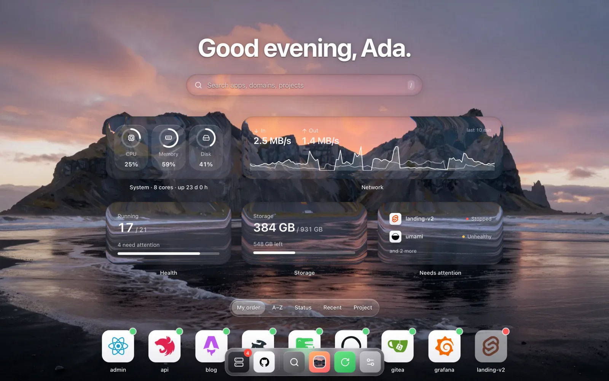
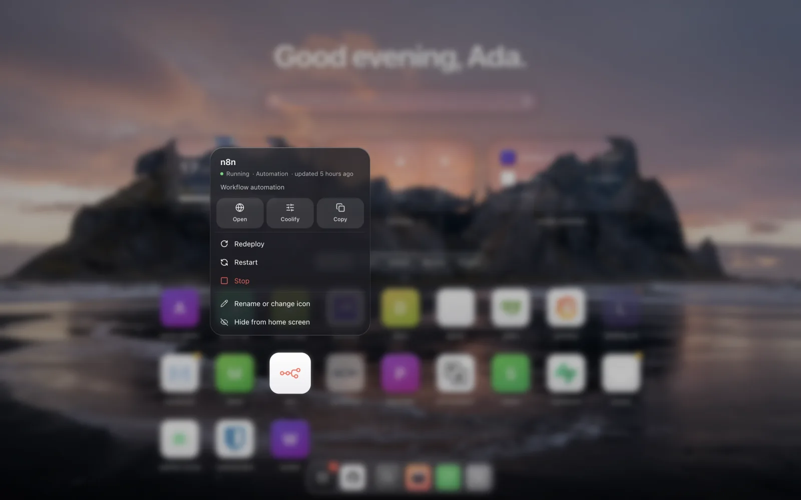
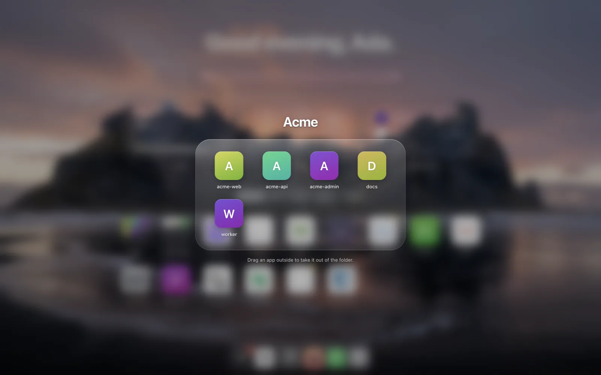
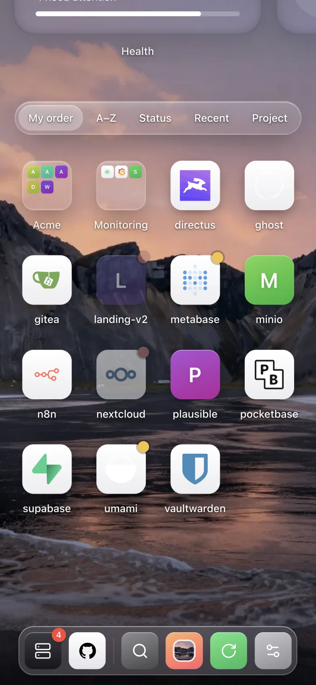

<div align="center">

# Launchpad for Coolify

**A liquid-glass home screen for everything you run on [Coolify].**
Every app and service with its logo, status and domains, one click away. Drag icons around, make folders, search, and redeploy from a long-press.

[](https://github.com/younesehb/coolify-dashboard/actions/workflows/ci.yml)
[](LICENSE)
[](https://github.com/younesehb/coolify-dashboard/pkgs/container/coolify-dashboard)



</div>

## Features

- **Pulls everything from Coolify.** Give it an API token; applications, one-click services, projects, environments, domains and status are read live. Nothing to configure per app.
- **Real logos.** Service icons come from Coolify's own template catalog; apps use their site's favicon or touch icon. No logo? You get a tidy monogram, or set your own.
- **iPhone-style home screen.** Wallpaper, greeting, glass widgets (health, instance totals, what needs attention), an icon grid and a magnifying dock.
- **Direct drag and drop.** Drag any icon to rearrange; your order is saved. Hold an icon over another to make a **folder**, like iOS.
- **Peek card.** Right-click or long-press an icon for status, last update, every domain, quick links to Coolify and the repo, and actions.
- **Redeploy, restart, stop, start** from the peek card, with a progress ring on the icon until Coolify finishes. Off unless you set a password.
- **Search** as you type, or `⌘K` for a Spotlight-style finder. `/` jumps to search.
- **Sort** by your order, name, status, most recent deploy or project, with animated reflow.
- **Live status.** Refreshes in the background and tells you when something goes down or comes back.
- **Make it yours.** Wallpapers (or upload your own), glass blur and frost, icon size, widgets, dock, labels, hidden apps, renamed apps, custom icons. Export and import your setup.
- **Works on phones.** Four icons per row, swipeable widgets, touch-and-hold to drag.

| Peek card and actions                    | Folders                                 | Phone                                  |
| ---------------------------------------- | --------------------------------------- | -------------------------------------- |
|  |  |  |

## Try it in 10 seconds

No Coolify needed: demo mode serves sample data.

```sh
docker run --rm -p 3000:3000 -e DEMO=true ghcr.io/younesehb/coolify-dashboard
```

Open <http://localhost:3000>.

## Deploy

### 1. Create a Coolify API token

In Coolify go to **Keys & Tokens → API tokens** and create one.

- **read** is enough to browse.
- **deploy** is also needed if you want the Redeploy / Restart / Stop / Start actions.

Give it the smallest permission you need. Launchpad keeps the token on the server; browsers never see it.

### 2a. Deploy on Coolify (recommended)

1. **New resource → Docker Image**, image `ghcr.io/younesehb/coolify-dashboard:latest`, port `3000`.
   (Or **Public repository** with this repo and the **Dockerfile** build pack.)
2. Add the environment variables below. When Launchpad runs on the same server as Coolify, use `COOLIFY_URL=http://coolify:8080`: it talks to Coolify over the internal Docker network and skips any proxy or Cloudflare Access in front of the dashboard.
3. Set a domain and deploy.

### 2b. Docker Compose anywhere

```sh
curl -O https://raw.githubusercontent.com/younesehb/coolify-dashboard/main/docker-compose.yml
COOLIFY_URL=https://coolify.example.com COOLIFY_TOKEN=... docker compose up -d
```

## Configuration

| Variable             | Required | Description                                                                                                   |
| -------------------- | -------- | ------------------------------------------------------------------------------------------------------------- |
| `COOLIFY_URL`        | yes      | Coolify base URL, e.g. `https://coolify.example.com` or `http://coolify:8080` on the same server.             |
| `COOLIFY_TOKEN`      | yes      | Coolify API token.                                                                                            |
| `COOLIFY_PUBLIC_URL` | no       | Where "Manage in Coolify" links point. Defaults to `COOLIFY_URL`; set it when that URL is internal.           |
| `ACTIONS_PASSWORD`   | no       | Turns on Redeploy / Restart / Stop / Start. Without it the buttons are hidden and the server refuses actions. |
| `OWNER_NAME`         | no       | Name in the greeting ("Good morning, Ada.").                                                                  |
| `DEMO`               | no       | `true` serves sample data and fake actions. No Coolify needed.                                                |
| `PORT`               | no       | Port to listen on. Default `3000`.                                                                            |

Everything else (wallpaper, layout, folders, hidden apps…) is a per-browser preference in **Customise** (the slider icon in the dock, or `⌘,`).

## Security

Read this before putting Launchpad on the internet.

- **Anyone who can open the page sees your app names, domains and repo links.** Put it behind authentication: Coolify's built-in HTTP Basic Auth on the resource, Cloudflare Access, Tailscale, or your VPN.
- **The token never reaches the browser.** The server calls Coolify and returns a trimmed list (no environment variables, compose files or credentials).
- **Actions need `ACTIONS_PASSWORD`**, compared in constant time, with a growing delay after wrong attempts. Use a long random value, e.g. `openssl rand -base64 18`. Every action also asks for a second tap to confirm.
- **Icon fetching is not an open proxy**: the server only fetches favicons for domains that belong to your Coolify apps.
- Responses carry a strict Content-Security-Policy, `nosniff` and `no-referrer`.

Found a vulnerability? See [SECURITY.md](SECURITY.md).

## How it works

```
Browser ──► Launchpad server (Node, no dependencies) ──► Coolify API
            ├─ /api/apps        applications + services + projects, normalised, cached 30 s
            ├─ /api/icon        favicon resolver for known app domains
            ├─ /api/action      redeploy / restart / stop / start (password protected)
            └─ /api/deployment  deployment status for the progress ring
```

The front end is React with Vite and Tailwind CSS, [motion] for animation, [dnd-kit] for drag and drop, and two [React Bits] components: `GlassSurface` for the refracting glass and `Dock` for the macOS-style dock.

## Development

Requires Node 20 or newer.

```sh
npm install
npm run demo                 # build and serve with sample data on :3000
```

For live editing against a real Coolify:

```sh
cp .env.example .env         # fill in COOLIFY_URL and COOLIFY_TOKEN
npm run dev:server           # API on :3000, reloads on change
npm run dev                  # Vite on :5173, proxies /api to :3000
```

`npm run check` runs formatting, a syntax check of the server, and a production build. CI runs the same plus a demo-mode smoke test and a Docker build. See [CONTRIBUTING.md](CONTRIBUTING.md).

## Credits

- [Coolify] for the platform and its service logo catalog.
- [React Bits] by David Haz for `GlassSurface` and `Dock` (MIT + Commons Clause, see [THIRD_PARTY_NOTICES.md](THIRD_PARTY_NOTICES.md)).
- [lucide](https://lucide.dev) icons, [motion], [dnd-kit].
- Wallpapers were generated for this project with Z-Image Turbo and are released with it under the MIT license.

## License

[MIT](LICENSE). Vendored third-party components keep their own licenses, listed in [THIRD_PARTY_NOTICES.md](THIRD_PARTY_NOTICES.md).

Launchpad is a community project and is not affiliated with Coolify.

[Coolify]: https://coolify.io
[React Bits]: https://reactbits.dev
[motion]: https://motion.dev
[dnd-kit]: https://dndkit.com
